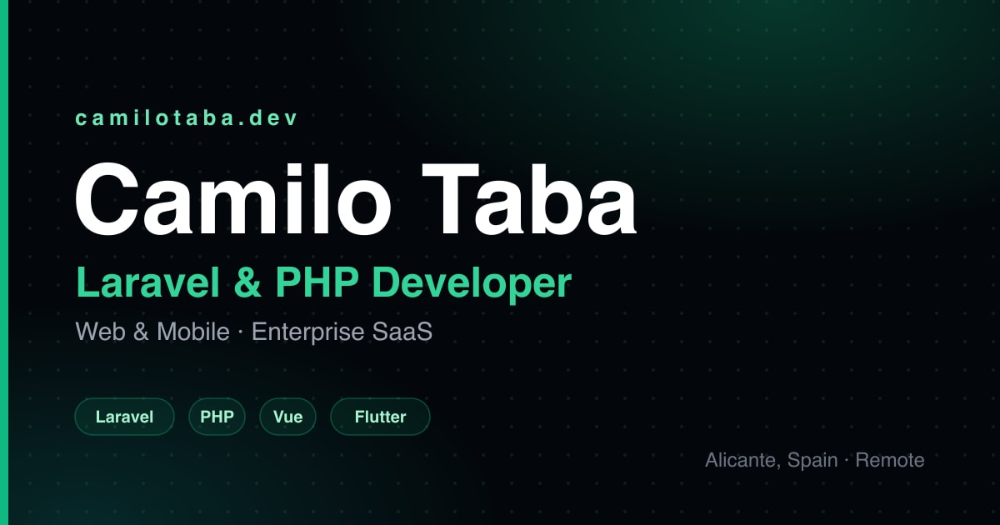

# camilotaba.dev

Personal portfolio of **Camilo Taba** — Laravel & PHP developer (web & mobile).

**Live site:** [camilotaba.dev](https://camilotaba.dev) · [Versión en español](https://camilotaba.dev/es/)



## What's inside

A fully static, bilingual (EN/ES) single-page portfolio built with Astro and Tailwind CSS. No JS framework on the client — just a few small vanilla TypeScript modules for the interactive bits.

### Highlights

- **i18n without a library** — a tiny `t()` helper over two JSON dictionaries (`src/i18n/`), with per-locale routes (`/` and `/es/`), `hreflang` alternates and localized metadata.
- **Technical SEO / GEO** — JSON-LD `@graph` (Person, WebSite, ProfilePage), Open Graph + Twitter cards, sitemap, and an [`llms.txt`](public/llms.txt) so AI crawlers get a clean summary of the profile.
- **Accessibility** — WAI-ARIA tabs with roving tabindex and arrow-key navigation, skip link, `aria-label`s throughout.
- **Performance** — static output, inlined critical CSS, WebP images via `astro:assets`, async non-blocking fonts, viewport-based prefetch. Monitored with Vercel Analytics + Speed Insights.
- **Scroll-driven UI** — reveal-on-scroll and progress indicators in plain CSS/TS, no animation library.

## Tech stack

[Astro 5](https://astro.build) · [Tailwind CSS 4](https://tailwindcss.com) · TypeScript · Vercel

## Project structure

```
src/
├── components/   # Header, Home (hero), Projects, Experience, ContactForm, Footer…
├── data/         # projects.ts, experience.ts, seo.ts, socials.ts (single sources of truth)
├── i18n/         # en.json, es.json + t() helper
├── icons/        # Inline SVG icon components
├── layouts/      # Layout.astro (head, SEO, JSON-LD)
├── pages/        # index.astro (EN) and es/index.astro (ES)
├── scripts/      # scroll-animations, project-tabs, contact-form (vanilla TS)
└── styles/       # global.css + per-section styles
```

## Commands

| Command           | Action                                 |
| ----------------- | -------------------------------------- |
| `npm install`     | Install dependencies                   |
| `npm run dev`     | Start dev server at `localhost:4321`   |
| `npm run build`   | Build the production site to `./dist/` |
| `npm run preview` | Preview the production build locally   |

The social share card (`public/og-image.jpg`) is generated with `node scripts/generate-og.mjs`.
The downloadable CVs (`public/CamiloTaba-CV*.pdf`) are print-rendered locally from HTML
sources kept outside the repo.

## Contact

- Website: [camilotaba.dev](https://camilotaba.dev)
- LinkedIn: [linkedin.com/in/camilotaba](https://www.linkedin.com/in/camilotaba/)
- GitHub: [@Camiiilotaba](https://github.com/Camiiilotaba)
- Email: camilotaba.dev@gmail.com
